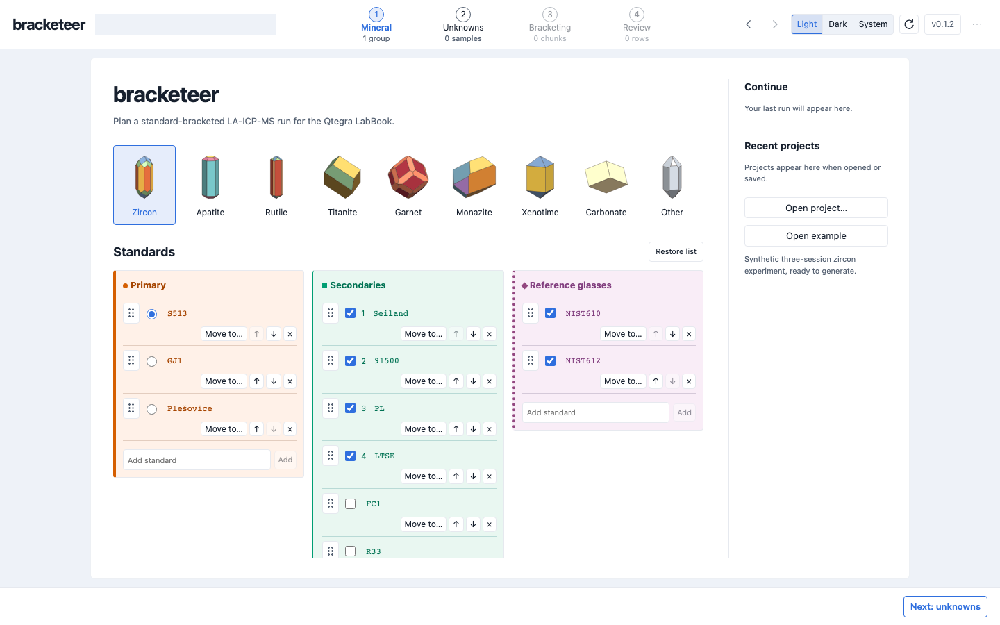

# bracketeer

bracketeer turns unknowns and standard spot ranges into a standard-bracketed LA-ICP-MS run sequence for the Thermo Qtegra LabBook. You can edit the rows, share standard pools across sessions, save a project, and export `.xls` (BIFF8, the default), `.xlsx`, CSV or Qtegra clipboard text. It runs offline as a Windows executable, a Mac app or a single HTML file.

## At the instrument in four steps

Open bracketeer: on Windows, double-click `bracketeer.exe`; on Mac, open the app; or open `bracketeer.html` in Edge. The step bar at the top shows where you are (**1 Mineral, 2 Unknowns, 3 Bracketing, 4 Review**). **Back** never loses what you typed, and **Next** stays disabled until the step is complete, with the reason shown beside it.

1. **Mineral.** Click the mineral you are dating. Its standards appear below in three groups: the primary, the secondaries (their order is the rotation) and the reference glasses. Zircon starts with S513 as primary, Seiland, 91500, PL and LTSE as secondaries, and NIST610 and NIST612. Tick, rename, reorder or add standards; your list is remembered for that mineral. **Continue**, **Recent projects** and **Open project** are on the same panel.

   

2. **Unknowns.** One row per sample: name, optional tag, and spots as any mix of ranges and single numbers, for example `1-30, 35, 40-42`. The app sorts them, removes duplicates and shows the result with the count. You can also paste one sample per line (`SYN-H3 S 1-30`). Fill in each standard's **Pool** and **Used** spots in the same way. Overlapping spots, spots inside a standard pool and duplicate names are flagged on their row. **Import sequence** brings in an earlier session.

   

3. **Bracketing.** Check the recipe: **Auto from budget** (the default, uses the standards up exactly), **Chunk target** or **Chunk count**, keep-spare, blocks. The summary on the right updates as you change values: sessions, chunks, brackets, secondary pairs and what each standard has left. Click **Generate and review**.

   

4. **Review.** Edit rows if needed and check the warnings below the grid (click one to select its rows). Then click **Export .xls**, or **Copy for Qtegra** and paste into the LabBook sample list. **Qtegra paste** shows exactly the rows that are copied (no header). **Start another session** marks this one as run and takes you to step 2 for the next.

   

## Projects and sessions

**Save project** writes `<experiment>.bracketeer.json`; **Open project** restores it. One project holds the experiment defaults, standards, recipe and all sessions. Each session has its own unknowns and sequence sheet; exports use the selected session. The app also autosaves on this computer. Save a project file to move it to another computer.

**Generate** plans all open (planned) sessions together. If any have manual edits, it asks before replacing them. Imported sessions are fixed. **Mark as run** fixes the current rows and moves the secondary rotation past their last pair. Fixed sessions count their standard spots as used and are not regenerated. **Unlock** makes a fixed session editable again.

**Start another session** (step 4) marks the current session as run and adds an empty next session; **+ Session** (step 2) adds an open session that is planned together with the others. The standards, used spots and recipe remain shared. A saved project remembers its mineral and the step it was left on, and opens there.

## Recipe

The default recipe opens with reference standards and the primary, then follows every chunk of unknowns with secondary pairs and the primary, adding a mid block and a closing block. **Auto from budget** shares the available standards across planned sessions; **Chunk target** and **Chunk count** let you choose the spacing instead (see [the recipe](docs/recipe.md)).

## Downloads and builds

The files to copy are `dist/windows/bracketeer.exe`, `dist/macos/bracketeer.app` (also supplied as a `.dmg`) or `dist/bracketeer.html`. The Windows executable is one file with no installer. See [Windows and Mac setup](docs/windows.md) for the runtime, unsigned-app prompts and build requirements.

| Command           | Purpose                                                                          |
| ----------------- | -------------------------------------------------------------------------------- |
| `make setup`      | Install dependencies with pnpm                                                   |
| `make dev`        | Start the Vite development server                                                |
| `make check`      | Check formatting, lint, types, unit tests and host Rust checks                   |
| `make rust-check` | Generate icons if needed; check Rust formatting, Clippy and Rust tests           |
| `make test`       | Run `make check`, build the standalone HTML and run all Playwright tests         |
| `make e2e`        | Run Playwright; the standalone-file test needs `make web` first                  |
| `make build`      | Build the regular web app into `dist/`                                           |
| `make web`        | Build the offline, single-file `dist/bracketeer.html`                            |
| `make icons`      | Generate PNG, ICO and ICNS icons from the SVG                                    |
| `make desktop`    | Build the Tauri frontend in `dist/tauri/` and Mac bundles in `src-tauri/target/` |
| `make windows`    | Cross-build the portable exe into `dist/windows/bracketeer.exe`                  |
| `make mac-app`    | Run `make desktop` and copy the `.app` and `.dmg` to `dist/macos/`               |

## Updates

The version chip is at the bottom-right on every step. Click it to open Updates.
Use **Check now** for an explicit check; a dot marks an available or ready update.
Automatic downloads are on by default; use **Restart to update** when ready.
Choose **Stable** or **Beta (pre-releases)** in the panel.
Installed Windows copies and macOS update in place; the portable exe is replaced by hand.
The browser build links to GitHub releases and does not update itself.
See [in-app updates](docs/in-app-updates.md) for the release flow.
Owner setup: run `pnpm updater:setup` once with `cargo tauri` 2 and `gh` available,
back up `~/.tauri/bracketeer-updater.key`, and commit the public-key config change.
The script sets `TAURI_SIGNING_PRIVATE_KEY`, or prints how to add it by hand.

## Development

Use Node.js 22.18+ or 24+ and pnpm 10 (the package pins pnpm 10.33.0). Run `make setup`, then `make dev`. The app uses Svelte 5, strict TypeScript and Vite; the pure engine is in `src/lib/engine/`. Excel import and export use SheetJS 0.20.3 from its official tarball. The wizard is described in [docs/wizard.md](docs/wizard.md). The mineral tiles are static SVGs rendered by `scripts/make_minerals.py` from [mineral-habit-matrix](https://github.com/duserzym/mineral-habit-matrix).

Run `make check` for Prettier (including Markdown), ESLint, `svelte-check`, Vitest and host Rust checks. These checks need Rust, `cargo tauri` 2 and Xcode Command Line Tools on the Mac; they generate icons if needed. Run `pnpm format` to apply formatting.

Run `make test` before finishing a change. It also runs Playwright in Chromium and WebKit, which needs the Playwright **1.64.1** browser builds available locally. `make setup` does not download browsers. Tests compare generated sessions 2 and 3 with the golden workbooks cell for cell, including cell types, both from the example project and typed from scratch through the four steps, and check every step at 1440 × 900 and 1280 × 800. The standalone HTML is tested offline through `file://`.

## Licence

[MIT](LICENSE).
